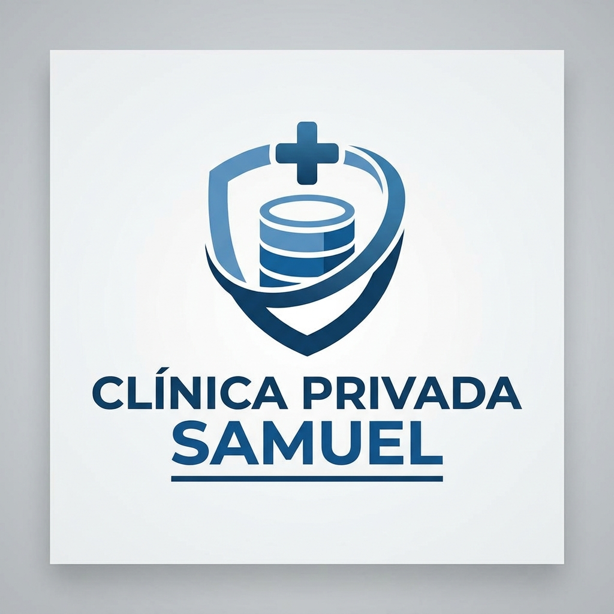

# 📘 Proyecto "Ingenieria de Datos 1 - UADE"

---

## Integrantes

- **MASI CAYETANO**
- **GIOIA BRUNO LORENZO**
- **BLAZQUEZ CATALINA MICAELA**
- **FORTEZ JUAN IGNACIO**

## Descripcion del proyecto

Este proyecto simula la gestión de una clínica privada y el control de la atención de sus pacientes, siendo una solución diseñada para optimizar la administración de los procesos médicos y administrativos de la institución. Su propósito es reemplazar los métodos manuales o poco estructurados utilizados habitualmente, permitiendo un control más claro y preciso sobre los turnos, las atenciones médicas, los estudios y las facturaciones.

El sistema facilita la gestión de turnos mediante la asignación de fechas, horarios y profesionales específicos, evitando conflictos de doble asignación de consultorios y profesionales, y permitiendo registrar el estado de cada turno en cada etapa del proceso. Además, permite registrar las atenciones médicas realizadas, los estudios solicitados a los pacientes y el seguimiento del estado de los mismos, con cálculo automático de los montos a cargo de la cobertura y del paciente al momento de facturar, diferenciando entre obras sociales, prepagas y pacientes particulares.

A través de esta herramienta, el personal administrativo y los profesionales podrán organizar y supervisar la atención de los pacientes de forma más eficiente, consultando el historial completo de cada paciente con sus datos personales, turnos, atenciones, estudios y pagos realizados. De esta manera, el sistema contribuye a mejorar la organización de la clínica, optimizar la utilización de los recursos disponibles y reducir errores asociados a la gestión manual.
